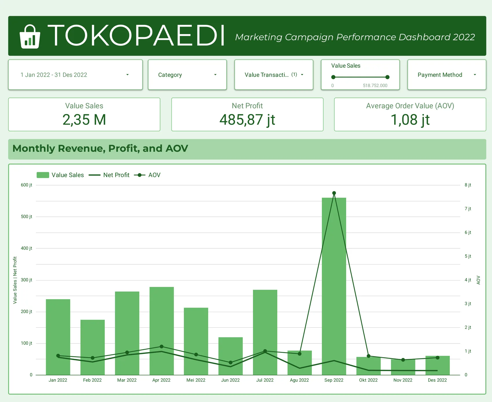
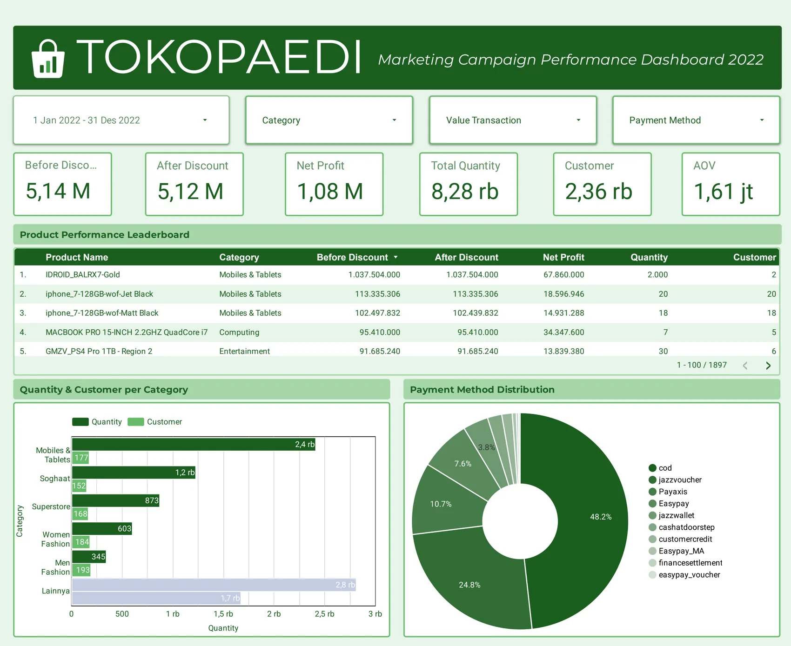
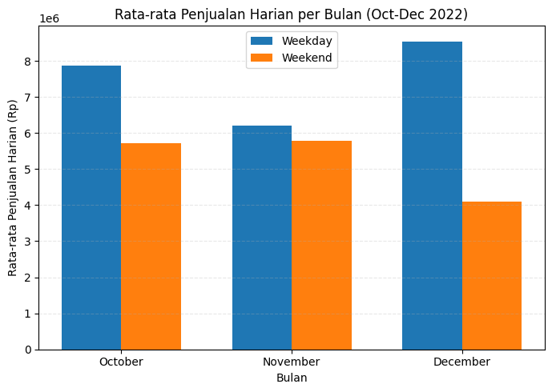

# MySkill E-commerce Data Analysis

**Final Project, Data Analysis: Fullstack Intensive Bootcamp (Batch 30)**

MySkill | September–November 2026 | Team C1 (11 members)

---

## Project Overview

### Page 1: Marketing Campaign Performance 2022


### Page 2: Product Details


Tokopaedi is a fictional e-commerce company used as the bootcamp dataset. The final project answers business requests from several internal teams (Board of Directors, Warehouse, Marketing, BI & CRM, Digital Marketing, Campaign) in three tracks: SQL in Google BigQuery, Python in Google Colab, and a Looker Studio dashboard.

This was a team project with 11 members. I worked across all three tracks: SQL, Python and the dashboard.

Live dashboard: [Looker Studio](https://datastudio.google.com/reporting/18cb42d8-79b2-4d17-b29b-1ec65e408fac)
Case study: [yaklut.github.io/portfolio](https://yaklut.github.io/portfolio/case-studies/myskill-data-analysis.html)

---

## Objectives

- Answer 5 business requests with SQL on 6 tables (2020–2024)
- Answer 4 business requests with pandas on a joined order table (2021–2022)
- Build a 2-page dashboard on 2022 sales, profit and payment behaviour
- Check each result against the raw data and flag where the data is too thin to support a conclusion

---

## Repository Structure

```
├── README.md
├── sql/
│   └── final_project.sql                    # 5 BigQuery queries, verified results as comments
├── python/
│   ├── final_project_python.ipynb           # Colab notebook with outputs
│   └── output/
│       ├── target_promo_ultah_2022.csv      # birthday-promo target list (820 customers)
│       ├── weekend-vs-weekday-by-month.png
│       └── weekend-vs-weekday-overall.png
└── dashboard/
    ├── page1-campaign-performance.png
    └── page2-product-details.png
```

---

## Dataset

**SQL track (BigQuery):** 6 tables, years 2020–2024.

| Table | Used for |
|---|---|
| `transaction_detail` | Monthly sales (`total_paid`) |
| `order_detail` | Quantity, channel revenue, first purchase |
| `product_detail` | Product category |
| `customer_detail` | Registration date and channel |
| `payment_detail` | Payment method |
| `funnel_detail` | Funnel events per channel source |

**Python and dashboard track:** one joined table `df` (order_detail + payment_detail + sku_detail + customer_detail, joined with SQLite inside Colab). Years 2021–2022, 15 categories, 10 payment methods. The notebook loads the CSV files from the bootcamp's public source, so it runs as is.

The raw data is not included in this repository.

---

## Tools Used

- **Google BigQuery**: SQL (CTEs, self-joins, `SAFE_DIVIDE`)
- **Python**: pandas, NumPy, Matplotlib, Seaborn, SQLite (Google Colab)
- **Looker Studio**: interactive dashboard

---

## Methodology Notes

- **Year filters use `EXTRACT(YEAR FROM ...)`, not `BETWEEN '...-12-31'`.** On timestamp columns, `BETWEEN` drops events on 31 December. An earlier version of the funnel query undercounted events (28,976 / 27,676 / 26,128) for this reason.
- **`SAFE_DIVIDE`** returns NULL instead of an error when the divisor is 0.
- **`NULLIF(order_id, '')`** stops empty strings from being counted as orders in the funnel.
- **Year-over-year by month:** the brief said "MoM vs the same month in 2023", but that comparison is year-over-year, so the column is named `yoy_growth_pct`. It is built with a self-join on a monthly CTE.
- **Python, request 2:** an outer merge with `fillna(0)` keeps products that sold in one year but not the other.
- **Dashboard formulas:** Net Profit = SUM(before_discount) − SUM(cogs × qty_ordered); AOV = SUM(before_discount) / COUNT_DISTINCT(id).

---

## Key Findings

### SQL (BigQuery)

| # | Request | Finding |
|---|---|---|
| 1 | Monthly sales 2024 (BoD) | December Rp4,116,290,940 = 17.7% of 2024 sales, about 2× the monthly average and +93% vs November. Q4 = 34% of yearly revenue (Rp7.98B). |
| 2 | Quantity per category 2020–2024 (Warehouse) | Fashion & Footwear became the largest category in 2024 (5,143 units, +85%). Total quantity was lowest in 2023 and rose 18.6% in 2024. |
| 3 | Channel performance 2024 vs 2023 (Marketing) | Offline Store Rp3.33B → Rp5.90B (+77%). App Store Rp5.78B → Rp4.73B (−18%) while orders fell only 4%, so the drop comes from a lower AOV (Rp5.08M → Rp4.32M). |
| 4 | Organic funnel 2024 (Marketing) | Website 2.16%, App Store 2.20%, Play Store 2.21%. A 0.05 pp gap is too small to call a difference in traffic quality. |
| 5 | New customers 2024 (BI & CRM) | 187 new customers: Mobile App 80, Website 63, Offline Store 44. Website buyers made their first purchase fastest (66.9 days on average). |

### Python (pandas)

| # | Request | Finding |
|---|---|---|
| 1 | Top 5 Mobiles & Tablets 2022 (Marketing) | IDROID_BALRX7-Gold leads with 1,000 units, but that comes from one large transaction, not many buyers. |
| 2 | "Others" category 2021 vs 2022 (Warehouse) | Others fell 426 → 263 units (−163), the steepest drop of 15 categories. Several products sold 0 in 2022. |
| 3 | Birthday-promo target list (Digital Marketing) | 1,052 orders → 820 unique customers, exported to `target_promo_ultah_2022.csv`. |
| 4 | Weekend campaign Oct–Dec 2022 (Campaign) | Weekday sales averaged Rp7,520,249 per day vs Rp5,269,300 on weekends (weekday 42.7% higher). The campaign is not shown to lift sales. |



### Dashboard (Looker Studio)

- 2022: Value Sales Rp5.14B, Net Profit Rp1.08B (21.0% margin), AOV Rp1.61M from 3,202 orders.
- Two 1,000-unit IDROID orders make up 20.2% of Value Sales and 24.2% of quantity but only 6.3% of Net Profit. Without them, AOV falls from Rp1.61M to Rp1.28M.
- The August–September AOV spike comes from those two orders. Margin in those months was 11.2% and 10.7%, compared with 25.1% in July.
- COD carries 48.2% of quantity. Repeat buyers are 15.0% of customers (353 of 2,359).
- Mobiles & Tablets paid with jazzwallet in 2022: 0 transactions.

---

## Data Caveats

- Q4 2022 only has data for days 1–8 of each month (24 days, 7 of them weekend days).
- August–December 2022 contain only 8–13 days of data each, so lower monthly orders are a data gap, not a sales drop.
- Monthly channel YoY ranges from −82% to +638% because each channel-month has only 47–174 orders.
- Offline Store, May 2024: 145 days to first purchase comes from 1 customer, not a trend.

---

## Recommendations

- Verify and separate outlier orders before reading AOV or margin trends.
- Review the weekend campaign, since weekday sales were higher in all three months.
- Run a churn-recovery promo for customers inactive for 30–60 days.
